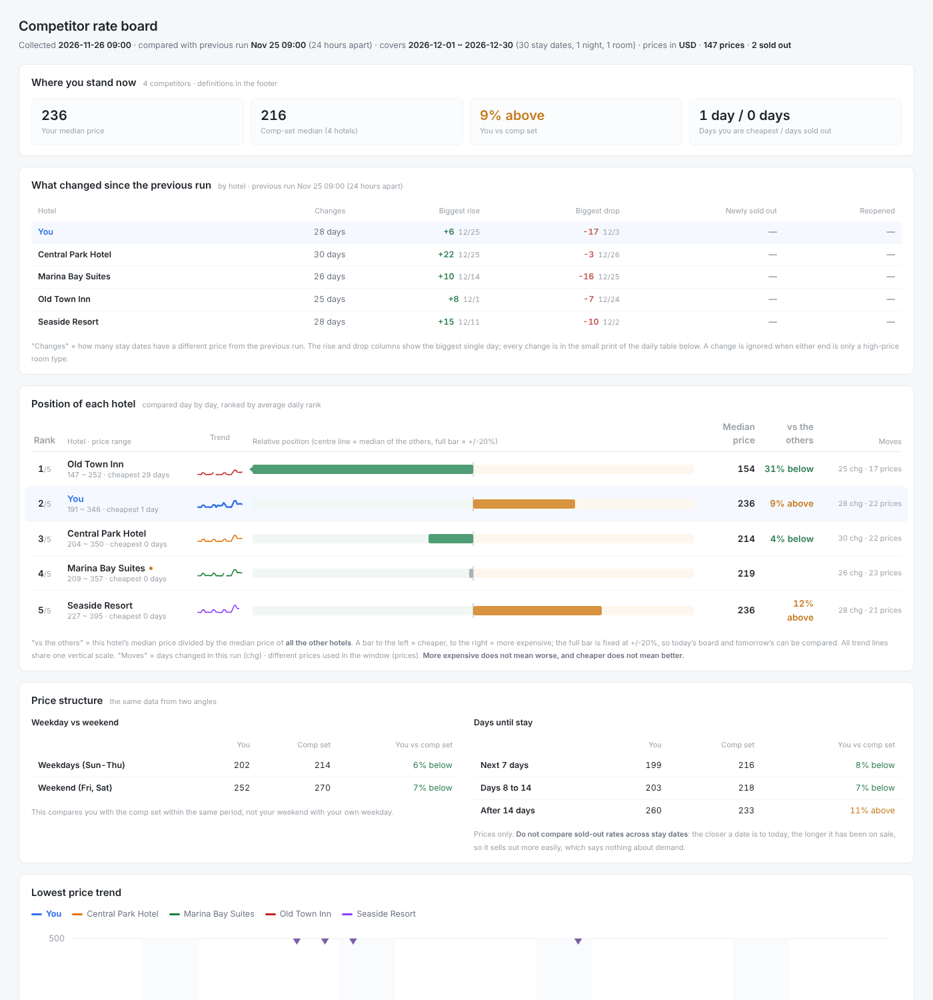

# Hotel Competitor Price Survey (Rate Board)

**An open-source competitor rate board for hotels, built around Ctrip.** Give it prices (collected with the Ctrip collector included here, or your own CSV), and it draws one
clear board: where you stand against your competitors today, what changed since the last run, a price trend chart,
a calendar and a daily table. It shows data only. It does not write conclusions for you.



## What price is this?

**Each hotel's lowest bookable price for the stay date** (the "from" price a channel shows), under the same search
conditions every run: 1 room, 1 night, 1 adult. It is the cheapest option across all room types and rate plans.
It does **not** filter by room type, cancellation policy or breakfast. Do not mix it with prices collected under other conditions.

## Read this first: Trip.com is not Ctrip

If your hotel is **outside China** and many of your guests are **from mainland China**, they mostly book on
**Ctrip (the Chinese-language site and app)**, not on Trip.com. The two can differ in inventory, currency and price
(how much differs depends on the hotel, so check your own property). Many commercial rate-shopping services find
Ctrip hard to cover because Ctrip limits automated access. Ask your vendor whether the Ctrip Chinese site is
included. This repository has a Ctrip collector for exactly this gap. See `docs/CHANNELS.md`. (The collector needs each hotel's name as Ctrip's Chinese site spells it. Search your hotel on the Ctrip Chinese site, or paste the English name into `ctrip_resolve.py`, which tries the English name too.)

## What it does

- **Where you stand now**: your median price, the competitor median, the gap, days you are cheapest, days sold out
- **What changed since the previous run**: by hotel, rises, drops, newly sold out, reopened
- **Position of each hotel**: rank, price range, trend, bar against the others
- **Price structure**: weekday vs weekend, and by how far ahead the stay date is
- **Trend chart, calendar and daily table**, ready to print or save as PDF
- Optional: your occupancy next to the prices, city events marked on the chart, and a collector option to refresh only selected dates (a partial run shows only those dates, so use a separate project folder for a focused board)

Design choices: one channel per board, median not mean, sold out and no price kept apart, suite-only days kept out of
the medians, no gap filling, no auto-written conclusions.

## Quick start (2 minutes, no account needed)

```bash
pip install playwright && playwright install chromium     # only needed for PDF/screenshots
python scripts/make_board.py --data-dir examples/sample_project
# open examples/sample_project/rate_board.html in your browser
python scripts/to_pdf.py --data-dir examples/sample_project   # optional PDF
```

With your own data: put one CSV per run in `my_project/archive/`, **named `run_<date>_<time>.csv`** (for example `run_2026-11-25_090000.csv`; format in `docs/DATA_FORMAT.md`). Keep `my_project` outside this repository folder, or it may get committed by mistake. Then

```bash
python scripts/make_board.py --data-dir my_project --home "Your Hotel"
```

## Where do the prices come from?

**Ctrip (mainland site)** through the built-in collector in `connectors/ctrip/` (author-tested).
The board reads a simple CSV (`docs/DATA_FORMAT.md`), so you can also import prices from another source yourself,
but only Ctrip is supported and tested. Use one channel per board and the same search conditions every run.
Details and the reasons are in `docs/CHANNELS.md`.

**Want another channel, or more than one?** Just say so in your task when you run the skill (for example, "collect Trip.com instead" or "add Agoda"). Your AI assistant can adapt the collector or build the CSV for that channel. The built-in collector and the tested setup are for Ctrip; for other channels, check the site's terms first.

## Risks, in plain words

Collecting prices automatically may be restricted by the platform's terms, and platforms may limit or block
accounts that search too often. You decide what to collect and how often, and you are responsible for following
the terms of any site you use. The authors give no warranty (see `LICENSE`).

## Contributing

Pull requests are welcome: fixes when Ctrip changes its page, other connectors, translations, board improvements.
Read `CONTRIBUTING.md`. Questions and ideas: open an issue.

## About the author

**Oriental Horizon Hotel Services** is a hotel management and consulting company. The founder is a hotel revenue
leader with 13 years in international hotel groups (Hilton, IHG, Accor, Hyatt) across Southeast Asia and China, a former
Director of Revenue at a five-star hotel in Singapore, and the head of a company that turned a loss-making
four-star hotel in a tier-3 city into a profitable one.

**Who we help**: hotel owners and hotel professionals (revenue, sales, marketing and general managers) who face a problem at work, especially at international brand and group hotels, where our own experience runs deepest.

**What we can help with**

- **Hotel business consulting**: how to get your hotel's business going and growing. We find where the business is strong and weak and what to do about it
- **OTA channel consulting**: how your hotel sells on the booking platforms, and how to improve it
- **AI for hotels**: we help your team put AI into daily operations, through training or by building the tools for you
- **Hands-on coaching**: we work alongside you and your team over time until the results show, not just hand over a report
- **Training**: courses on hotel business and AI, open to owners, hotel staff and students

**Free consultation: tell us your situation and we will tell you honestly whether we can help.**

- LinkedIn: https://www.linkedin.com/in/ludan-zhang54/
- WeChat: Oriental_Horizon
- WhatsApp: +65 86796635
- Email: ludanzhang54@gmail.com
- YouTube (Chinese-language videos and podcast): https://www.youtube.com/@TheHotelBusiness
- Podcast, English: *The Hotel Business* - https://rss.com/podcasts/the-hotel-business/
- Podcast, Chinese: *张小姐看酒店生意* - https://www.youtube.com/playlist?list=PLK66NvWFLv9U (also on Ximalaya and Xiaoyuzhou)

## Licence

MIT. Free to use, change and share, including commercially. See `LICENSE`.
